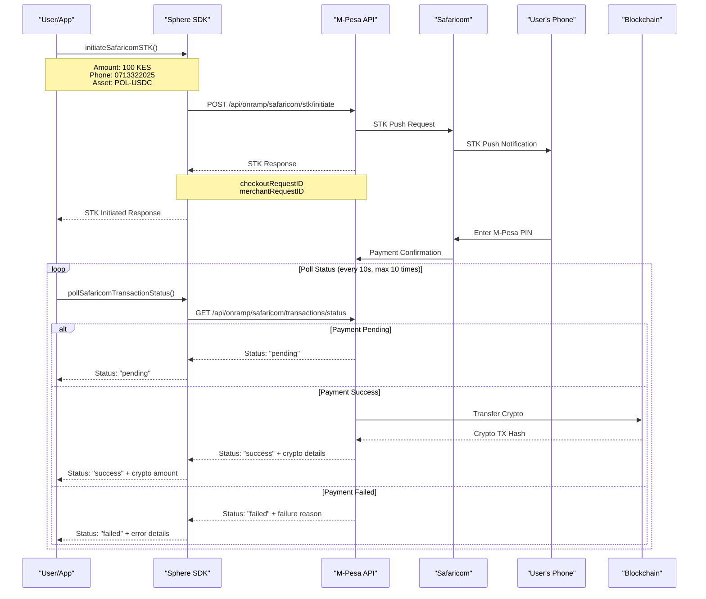

# Sphere M-Pesa Onramp Documentation

## Table of Contents

- [Overview](#overview)
- [How It Works](#how-it-works)
- [Flow Diagram](#flow-diagram)
- [Getting Started](#getting-started)
- [API Reference](#api-reference)
- [Code Examples](#code-examples)
- [Transaction History](#transaction-history)
- [Error Handling](#error-handling)
- [Best Practices](#best-practices)
- [Troubleshooting](#troubleshooting)
- [Use Cases](#use-cases)

## Overview

Sphere M-Pesa Onramp is a seamless integration that allows Kenyan users to convert their Kenyan Shillings (KES) directly into cryptocurrency using Safaricom's M-Pesa mobile money platform. This feature enables instant crypto purchases through the familiar M-Pesa STK Push interface.

### Key Features

- **🚀 Instant Conversion**: Convert KES to crypto in real-time
- **📱 STK Push Integration**: Familiar M-Pesa payment flow
- **🔄 Auto-Polling**: Automatic transaction status monitoring
- **📊 Transaction History**: Complete transaction tracking and filtering
- **🔐 Secure**: Enterprise-grade security and reliability
- **💱 Multi-Asset Support**: Support for popular crypto assets

### Supported Crypto Assets

| Asset         | Description       | Network   |
| ------------- | ----------------- | --------- |
| **POL-USDC**  | USDC on Polygon   | Polygon   |
| **BERA-USDC** | USDC on Berachain | Berachain |
| **ETH**       | Ethereum          | Ethereum  |
| **WBERA**     | Wrapped BERA      | Berachain |

## How It Works

The Sphere M-Pesa onramp process involves three main components:

1. **STK Push Initiation**: Trigger M-Pesa payment request to user's phone
2. **Payment Processing**: User completes payment on their phone
3. **Crypto Transfer**: Automatic crypto transfer to user's wallet

### Process Flow

1. **User initiates onramp** with amount, phone number, and crypto preferences
2. **System sends STK push** to user's M-Pesa registered phone
3. **User enters M-Pesa PIN** on their phone to complete payment
4. **System monitors payment status** and processes crypto transfer
5. **Crypto is transferred** to user's specified wallet address

## Flow Diagram

The sequence diagram below shows the complete M-Pesa onramp flow from initiation to completion.



## Getting Started

### Prerequisites

- Node.js 16+ or compatible JavaScript environment
- Sphere SDK installed
- Valid Sphere API key
- M-Pesa API access (optional for custom configurations)

### Installation

```bash
npm install @stratosphere-network/wallet
```

### Basic Setup

```typescript
import { Sphere, Environment } from "@stratosphere-network/wallet";

// Initialize Sphere SDK
const sphere = new Sphere({
  apiKey: "your-sphere-api-key",
  environment: Environment.PRODUCTION, // or Environment.DEVELOPMENT
  timeout: 30000, // Optional: request timeout in ms
  retries: 3, // Optional: retry attempts
});

// Optional: Set M-Pesa specific API key if different from main API key
sphere.setMpesaApiKey("your-mpesa-api-key");
```

### Quick Start Example

```typescript
async function quickMpesaOnramp() {
  try {
    // Step 1: Initiate STK push
    const response = await sphere.onramp.initiateSafaricomSTK({
      amount: 100, // 100 KES
      phone: "0713322025", // User's M-Pesa phone
      cryptoAsset: "POL-USDC",
      cryptoWalletAddress: "0x31DEBea3ba4101bb582dc31fDB3068bE686791b0",
      externalReference: "user_12345",
    });

    console.log("STK Push sent:", response.data.checkoutRequestID);

    // Step 2: Auto-poll for completion
    const result = await sphere.onramp.pollSafaricomTransactionStatus(
      response.data.checkoutRequestID,
      undefined,
      10, // max attempts
      10000 // 10 second intervals
    );

    // Step 3: Handle result
    if (result.status === "success") {
      console.log("✅ Onramp successful!");
      console.log("Crypto amount:", result.data.cryptoAmount);
      console.log("TX hash:", result.data.cryptoTxHash);
    }
  } catch (error) {
    console.error("Onramp failed:", error.message);
  }
}
```

## API Reference

### Core Methods

#### `initiateSafaricomSTK(request)`

Initiates an M-Pesa STK push for crypto onramping.

**Parameters:**

```typescript
interface MpesaSTKInitiateRequest {
  email?: string; // Optional user email
  amount: number; // Amount in KES (Kenyan Shillings)
  phone: string; // M-Pesa phone number (e.g., "0713322025")
  cryptoAsset: "POL-USDC" | "BERA-USDC" | "ETH" | "WBERA";
  cryptoWalletAddress: string; // Destination wallet address
  externalReference: string; // Unique identifier (user ID, telegram ID, etc.)
}
```

**Response:**

```typescript
interface MpesaSTKInitiateResponse {
  success: boolean;
  message: string;
  data: {
    message: string;
    merchantRequestID: string;
    checkoutRequestID: string;
    safaricomResponse: {
      MerchantRequestID: string;
      CheckoutRequestID: string;
      ResponseCode: string;
      ResponseDescription: string;
      CustomerMessage: string;
    };
    cryptoIntent: {
      asset: string;
      walletAddress: string;
    };
    note: string;
  };
}
```

**Example:**

```typescript
const stkResponse = await sphere.onramp.initiateSafaricomSTK({
  email: "user@example.com", // Optional
  amount: 500, // 500 KES
  phone: "0713322025",
  cryptoAsset: "POL-USDC",
  cryptoWalletAddress: "0x31DEBea3ba4101bb582dc31fDB3068bE686791b0",
  externalReference: "telegram_user_67890",
});
```

#### `getSafaricomTransactionStatus(request)`

Gets the current status of a Safaricom transaction.

**Parameters:**

```typescript
interface MpesaTransactionStatusRequest {
  checkoutRequestId?: string; // From STK initiation response
  merchantRequestId?: string; // From STK initiation response
}
```

**Response:**

```typescript
interface MpesaTransactionStatusResponse {
  success: boolean;
  status: "pending" | "success" | "failed";
  data: {
    id: string;
    checkoutRequestId: string;
    merchantRequestId: string;
    status: "pending" | "success" | "failed";
    amount: number;
    currency: string;
    phoneNumber: string;
    mpesaReceiptNumber: string | null;
    transactionDate: string | null;
    cryptoStatus: "pending" | "success" | "failed" | null;
    cryptoTxHash: string | null;
    cryptoAmount: number | null;
    amountInUSD: number | null;
    failureReason: string | null;
    cryptoFailureReason: string | null;
    // ... additional fields
  };
}
```

**Example:**

```typescript
// Check by checkout request ID
const status = await sphere.onramp.getSafaricomTransactionStatus({
  checkoutRequestId: "ws_CO_05062025134410304713322025",
});

// Or check by merchant request ID
const statusByMerchant = await sphere.onramp.getSafaricomTransactionStatus({
  merchantRequestId: "ed4e-4482-896f-139740cf342c4176666",
});
```

#### `pollSafaricomTransactionStatus(checkoutRequestId?, merchantId?, maxAttempts?, intervalMs?)`

Automatically polls transaction status until completion or timeout.

**Parameters:**

- `checkoutRequestId` (optional): Checkout request ID from STK initiation
- `merchantId` (optional): Merchant request ID from STK initiation
- `maxAttempts` (optional): Maximum polling attempts (default: 10)
- `intervalMs` (optional): Polling interval in milliseconds (default: 10000)

**Note**: At least one of `checkoutRequestId` or `merchantId` must be provided.

**Example:**

```typescript
// Poll using checkout request ID
const finalStatus = await sphere.onramp.pollSafaricomTransactionStatus(
  "ws_CO_05062025134410304713322025", // checkoutRequestId
  undefined, // merchantId not needed
  15, // max 15 attempts
  5000 // poll every 5 seconds
);

// Poll using merchant request ID
const finalStatusByMerchant =
  await sphere.onramp.pollSafaricomTransactionStatus(
    undefined, // checkoutRequestId not needed
    "ed4e-4482-896f-139740cf342c4176666", // merchantId
    10,
    10000
  );
```

#### `getUserTransactionHistory(filters?)`

Retrieves user's M-Pesa onramp transaction history with filtering and pagination.

**Parameters:**

```typescript
interface MpesaTransactionHistoryRequest {
  email?: string;
  externalReference?: string;
  status?: "pending" | "success" | "failed";
  cryptoStatus?: "pending" | "success" | "failed";
  cryptoTxHash?: string;
  mpesaReceiptNumber?: string;
  minAmount?: number;
  maxAmount?: number;
  startDate?: string; // YYYY-MM-DD format
  endDate?: string; // YYYY-MM-DD format
  page?: number;
  limit?: number;
  sortBy?: string;
  sortOrder?: "asc" | "desc";
}
```

#### `pollSafaricomTransactionStatus(checkoutRequestId?, merchantId?, maxAttempts?, intervalMs?)`

Automatically polls transaction status until completion or timeout.

**Parameters:**

- `checkoutRequestId` (optional): Checkout request ID from STK initiation
- `merchantId` (optional): Merchant request ID from STK initiation
- `maxAttempts` (optional): Maximum polling attempts (default: 10)
- `intervalMs` (optional): Polling interval in milliseconds (default: 10000)

**Note**: At least one of `checkoutRequestId` or `merchantId` must be provided.

**Example:**

```typescript
// Poll using checkout request ID
const finalStatus = await sphere.onramp.pollSafaricomTransactionStatus(
  "ws_CO_05062025134410304713322025", // checkoutRequestId
  undefined, // merchantId not needed
  15, // max 15 attempts
  5000 // poll every 5 seconds
);

// Poll using merchant request ID
const finalStatusByMerchant =
  await sphere.onramp.pollSafaricomTransactionStatus(
    undefined, // checkoutRequestId not needed
    "ed4e-4482-896f-139740cf342c4176666", // merchantId
    10,
    10000
  );
```

#### `getUserTransactionHistory(filters?)`

Retrieves user's M-Pesa onramp transaction history with filtering and pagination.

**Parameters:**

```typescript
interface MpesaTransactionHistoryRequest {
  email?: string;
  externalReference?: string;
  status?: "pending" | "success" | "failed";
  cryptoStatus?: "pending" | "success" | "failed";
  cryptoTxHash?: string;
  mpesaReceiptNumber?: string;
  minAmount?: number;
  maxAmount?: number;
  startDate?: string; // YYYY-MM-DD format
  endDate?: string; // YYYY-MM-DD format
  page?: number;
  limit?: number;
  sortBy?: string;
  sortOrder?: "asc" | "desc";
}
```

## Code Examples

### Complete Onramp Flow

```typescript
async function completeMpesaOnramp() {
  try {
    console.log("🚀 Starting M-Pesa onramp...");

    // Step 1: Initiate STK push
    const stkResponse = await sphere.onramp.initiateSafaricomSTK({
      amount: 1000, // 1000 KES
      phone: "0713322025",
      cryptoAsset: "POL-USDC",
      cryptoWalletAddress: "0x31DEBea3ba4101bb582dc31fDB3068bE686791b0",
      externalReference: "telegram_user_12345",
      email: "user@example.com", // Optional
    });

    console.log("📱 STK Push initiated:", stkResponse.data.checkoutRequestID);

    if (!stkResponse.success) {
      throw new Error(`STK initiation failed: ${stkResponse.message}`);
    }

    // Step 2: Auto-poll for completion
    console.log("⏳ Waiting for M-Pesa payment...");
    const result = await sphere.onramp.pollSafaricomTransactionStatus(
      stkResponse.data.checkoutRequestID,
      undefined,
      20, // Wait up to 20 attempts (200 seconds total)
      10000 // Check every 10 seconds
    );

    // Step 3: Handle final result
    switch (result.status) {
      case "success":
        console.log("🎉 Onramp successful!");
        console.log(
          `💰 Received: ${result.data.cryptoAmount} ${result.data.cryptoIntent.asset}`
        );
        console.log(`🔗 Crypto TX: ${result.data.cryptoTxHash}`);
        console.log(`📱 M-Pesa Receipt: ${result.data.mpesaReceiptNumber}`);
        console.log(`💵 USD Value: $${result.data.amountInUSD}`);
        break;

      case "failed":
        console.log("❌ Onramp failed");
        console.log(`💔 M-Pesa Error: ${result.data.failureReason}`);
        if (result.data.cryptoFailureReason) {
          console.log(`🔗 Crypto Error: ${result.data.cryptoFailureReason}`);
        }
        break;

      case "pending":
        console.log("⏳ Transaction still pending after maximum wait time");
        console.log("💡 Continue checking manually or extend polling time");
        break;
    }

    return result;
  } catch (error) {
    console.error("💥 M-Pesa onramp error:", error.message);
    throw error;
  }
}
```

### Transaction History Examples

```typescript
// Get successful transactions from last month
const successfulTxs = await sphere.onramp.getUserTransactionHistory({
  status: "success",
  cryptoStatus: "success",
  startDate: "2024-12-01",
  endDate: "2024-12-31",
  sortBy: "createdAt",
  sortOrder: "desc",
  limit: 50,
});

// Get high-value transactions
const highValueTxs = await sphere.onramp.getUserTransactionHistory({
  minAmount: 5000, // 5000 KES and above
  status: "success",
  sortBy: "amount",
  sortOrder: "desc",
});

// Get transactions for specific user
const userTxs = await sphere.onramp.getUserTransactionHistory({
  email: "user@example.com",
  externalReference: "telegram_12345",
  page: 1,
  limit: 10,
});
```

## Error Handling

### Comprehensive Error Handling

```typescript
async function robustMpesaOnramp(request: MpesaSTKInitiateRequest) {
  try {
    const stkResponse = await sphere.onramp.initiateSafaricomSTK(request);

    if (!stkResponse.success) {
      throw new Error(`STK initiation failed: ${stkResponse.message}`);
    }

    return await sphere.onramp.pollSafaricomTransactionStatus(
      stkResponse.data.checkoutRequestID
    );
  } catch (error: any) {
    // Handle specific HTTP errors
    switch (error.status) {
      case 400:
        console.error("❌ Bad Request:", error.message);
        if (error.message.includes("phone")) {
          throw new Error(
            "Please provide a valid M-Pesa phone number (e.g., 0713322025)"
          );
        } else if (error.message.includes("amount")) {
          throw new Error("Amount must be between minimum and maximum limits");
        } else if (error.message.includes("asset")) {
          throw new Error(
            "Unsupported crypto asset. Use POL-USDC, BERA-USDC, ETH, or WBERA"
          );
        }
        break;

      case 401:
        console.error("🔐 Unauthorized:", error.message);
        throw new Error(
          "Invalid API key. Please check your Sphere API credentials"
        );

      case 429:
        console.error("⏰ Rate Limited:", error.message);
        throw new Error("Too many requests. Please wait before retrying");

      case 500:
        console.error("🔧 Server Error:", error.message);
        throw new Error(
          "M-Pesa service is temporarily unavailable. Please try again later"
        );

      default:
        if (error.name === "TypeError" && error.message.includes("fetch")) {
          throw new Error(
            "Network error. Please check your internet connection"
          );
        }

        console.error("💥 Unexpected error:", error);
        throw new Error(
          "An unexpected error occurred. Please contact support if this persists"
        );
    }
  }
}
```

## Best Practices

### 1. Input Validation

```typescript
function validateMpesaRequest(request: MpesaSTKInitiateRequest): void {
  // Validate phone number format
  const phoneRegex = /^(?:\+254|254|0)?([7][0-9]{8})$/;
  if (!phoneRegex.test(request.phone)) {
    throw new Error("Invalid phone number format. Use format: 0713322025");
  }

  // Validate amount limits
  const minAmount = 1; // 1 KES
  const maxAmount = 150000; // 150,000 KES (current M-Pesa limit)

  if (request.amount < minAmount || request.amount > maxAmount) {
    throw new Error(`Amount must be between ${minAmount} and ${maxAmount} KES`);
  }

  // Validate wallet address
  const addressRegex = /^0x[a-fA-F0-9]{40}$/;
  if (!addressRegex.test(request.cryptoWalletAddress)) {
    throw new Error("Invalid wallet address format");
  }

  // Validate crypto asset
  const supportedAssets = ["POL-USDC", "BERA-USDC", "ETH", "WBERA"];
  if (!supportedAssets.includes(request.cryptoAsset)) {
    throw new Error(
      `Unsupported crypto asset. Use one of: ${supportedAssets.join(", ")}`
    );
  }
}
```

## Use Cases

### Telegram Bot Integration

```typescript
class TelegramMpesaBot {
  async handleOnrampCommand(
    telegramUserId: string,
    amount: number,
    phone: string,
    walletAddress: string
  ) {
    try {
      // Initiate onramp with Telegram user ID as reference
      const response = await sphere.onramp.initiateSafaricomSTK({
        amount,
        phone,
        cryptoAsset: "POL-USDC",
        cryptoWalletAddress: walletAddress,
        externalReference: `telegram_${telegramUserId}`,
      });

      // Send confirmation message
      await this.sendMessage(
        telegramUserId,
        `📱 STK push sent to ${phone}! Check your phone and enter your M-Pesa PIN.\n\n` +
          `💰 Amount: ${amount} KES\n` +
          `🎯 You'll receive: ~${(amount / 136).toFixed(4)} USDC\n` +
          `⏰ Please complete payment within 2 minutes.`
      );

      // Start monitoring in background
      this.monitorTransaction(telegramUserId, response.data.checkoutRequestID);
    } catch (error) {
      await this.sendMessage(
        telegramUserId,
        `❌ Failed to initiate M-Pesa payment: ${error.message}`
      );
    }
  }

  private async monitorTransaction(
    telegramUserId: string,
    checkoutRequestId: string
  ) {
    try {
      const result = await sphere.onramp.pollSafaricomTransactionStatus(
        checkoutRequestId,
        undefined,
        20, // 20 attempts
        15000 // 15 second intervals
      );

      switch (result.status) {
        case "success":
          await this.sendMessage(
            telegramUserId,
            `🎉 Payment successful!\n\n` +
              `💰 Received: ${result.data.cryptoAmount} ${result.data.cryptoIntent.asset}\n` +
              `🔗 TX Hash: ${result.data.cryptoTxHash}\n` +
              `📱 M-Pesa Receipt: ${result.data.mpesaReceiptNumber}`
          );
          break;

        case "failed":
          await this.sendMessage(
            telegramUserId,
            `❌ Payment failed: ${result.data.failureReason}\n\n` +
              `💡 You can try again with /onramp command.`
          );
          break;

        case "pending":
          await this.sendMessage(
            telegramUserId,
            `⏳ Payment is still processing. We'll notify you when it completes.\n\n` +
              `🔍 Transaction ID: ${result.data.id}`
          );
          break;
      }
    } catch (error) {
      await this.sendMessage(
        telegramUserId,
        `⚠️ Error monitoring payment: ${error.message}\n\n` +
          `💡 Please check your transaction history or contact support.`
      );
    }
  }

  private async sendMessage(telegramUserId: string, message: string) {
    // Implement Telegram bot message sending
    console.log(`📤 To ${telegramUserId}: ${message}`);
  }
}
```

### Web Application Integration

```typescript
class WebAppMpesaIntegration {
  async initiatePurchase(
    userId: string,
    amount: number,
    phone: string,
    walletAddress: string,
    onStatusUpdate: (status: any) => void
  ) {
    try {
      // Initiate M-Pesa onramp
      const response = await sphere.onramp.initiateSafaricomSTK({
        amount,
        phone,
        cryptoAsset: "POL-USDC",
        cryptoWalletAddress: walletAddress,
        externalReference: `webapp_${userId}`,
        email: await this.getUserEmail(userId),
      });

      // Start real-time monitoring
      this.startRealtimeMonitoring(
        response.data.checkoutRequestID,
        onStatusUpdate
      );

      return {
        success: true,
        checkoutRequestId: response.data.checkoutRequestID,
        message: "STK push sent to your phone",
      };
    } catch (error) {
      return {
        success: false,
        error: error.message,
      };
    }
  }

  private async startRealtimeMonitoring(
    checkoutRequestId: string,
    onStatusUpdate: (status: any) => void
  ) {
    try {
      onStatusUpdate({
        status: "monitoring",
        message: "Waiting for M-Pesa payment...",
      });

      const result = await sphere.onramp.pollSafaricomTransactionStatus(
        checkoutRequestId,
        undefined,
        24, // 4 minutes total
        10000 // 10 second intervals
      );

      onStatusUpdate({
        status: result.status,
        data: result.data,
        message:
          result.status === "success"
            ? "Payment successful!"
            : result.status === "failed"
            ? "Payment failed"
            : "Still processing",
      });
    } catch (error) {
      onStatusUpdate({
        status: "error",
        error: error.message,
      });
    }
  }

  private async getUserEmail(userId: string): Promise<string> {
    // Implement user email retrieval
    return "user@example.com";
  }
}
```

---

## Summary

Sphere M-Pesa Onramp provides a powerful, easy-to-use solution for converting Kenyan Shillings to cryptocurrency. With comprehensive error handling, real-time monitoring, and flexible integration options, it's perfect for any application serving Kenyan users.

### Key Benefits

- ✅ **Simple Integration**: Just a few lines of code to get started
- ✅ **Real-time Monitoring**: Automatic status polling and updates
- ✅ **Comprehensive History**: Advanced filtering and pagination
- ✅ **Error Resilience**: Robust error handling and retry logic
- ✅ **Production Ready**: Battle-tested in real-world applications

### Getting Help

- 📖 [Sphere Documentation](https://docs.sphere-id.com)
- 💬 [Discord Community](https://discord.gg/sphere)
- 📧 [Support Email](mailto:support@sphere-id.com)
- 🐛 [GitHub Issues](https://github.com/stratosphere-network/sphere-sdk/issues)

```typescript
async function completeMpesaOnramp() {
  try {
    console.log("🚀 Starting M-Pesa onramp...");

    // Step 1: Initiate STK push
    const stkResponse = await sphere.onramp.initiateSafaricomSTK({
      amount: 1000, // 1000 KES
      phone: "0713322025",
      cryptoAsset: "POL-USDC",
      cryptoWalletAddress: "0x31DEBea3ba4101bb582dc31fDB3068bE686791b0",
      externalReference: "telegram_user_12345",
      email: "user@example.com", // Optional
    });

    console.log("📱 STK Push initiated:", stkResponse.data.checkoutRequestID);

    if (!stkResponse.success) {
      throw new Error(`STK initiation failed: ${stkResponse.message}`);
    }

    // Step 2: Auto-poll for completion
    console.log("⏳ Waiting for M-Pesa payment...");
    const result = await sphere.onramp.pollSafaricomTransactionStatus(
      stkResponse.data.checkoutRequestID,
      undefined,
      20, // Wait up to 20 attempts (200 seconds total)
      10000 // Check every 10 seconds
    );

    // Step 3: Handle final result
    switch (result.status) {
      case "success":
        console.log("🎉 Onramp successful!");
        console.log(
          `💰 Received: ${result.data.cryptoAmount} ${result.data.cryptoIntent.asset}`
        );
        console.log(`🔗 Crypto TX: ${result.data.cryptoTxHash}`);
        console.log(`📱 M-Pesa Receipt: ${result.data.mpesaReceiptNumber}`);
        console.log(`💵 USD Value: $${result.data.amountInUSD}`);
        break;

      case "failed":
        console.log("❌ Onramp failed");
        console.log(`💔 M-Pesa Error: ${result.data.failureReason}`);
        if (result.data.cryptoFailureReason) {
          console.log(`🔗 Crypto Error: ${result.data.cryptoFailureReason}`);
        }
        break;

      case "pending":
        console.log("⏳ Transaction still pending after maximum wait time");
        console.log("💡 Continue checking manually or extend polling time");
        break;
    }

    return result;
  } catch (error) {
    console.error("💥 M-Pesa onramp error:", error.message);
    throw error;
  }
}
```

### Example 2: Manual Status Checking

```typescript
async function manualStatusTracking(checkoutRequestId: string) {
  const maxChecks = 5;
  let attempts = 0;

  while (attempts < maxChecks) {
    try {
      const status = await sphere.onramp.getSafaricomTransactionStatus({
        checkoutRequestId,
      });

      console.log(`📊 Status check ${attempts + 1}:`, status.status);

      if (status.status === "success" || status.status === "failed") {
        console.log("🏁 Final status:", status);
        return status;
      }

      // Wait 15 seconds before next check
      await new Promise((resolve) => setTimeout(resolve, 15000));
      attempts++;
    } catch (error) {
      console.error(`❌ Status check failed:`, error.message);
      attempts++;
    }
  }

  console.log("⏰ Maximum checks reached, transaction may still be processing");
}
```

### Example 3: Batch Processing

```typescript
async function batchMpesaOnramp(
  requests: Array<{
    phone: string;
    amount: number;
    walletAddress: string;
    reference: string;
  }>
) {
  const results = [];

  for (const request of requests) {
    try {
      console.log(`🚀 Processing onramp for ${request.phone}...`);

      const stkResponse = await sphere.onramp.initiateSafaricomSTK({
        amount: request.amount,
        phone: request.phone,
        cryptoAsset: "POL-USDC",
        cryptoWalletAddress: request.walletAddress,
        externalReference: request.reference,
      });

      results.push({
        phone: request.phone,
        checkoutRequestId: stkResponse.data.checkoutRequestID,
        success: stkResponse.success,
      });

      // Add delay between requests to avoid rate limiting
      await new Promise((resolve) => setTimeout(resolve, 2000));
    } catch (error) {
      console.error(
        `❌ Failed to initiate for ${request.phone}:`,
        error.message
      );
      results.push({
        phone: request.phone,
        error: error.message,
        success: false,
      });
    }
  }

  return results;
}
```

## Transaction History

### Comprehensive History Filtering

```typescript
async function demonstrateHistoryFiltering() {
  // Get all successful transactions from last month
  const successfulTxs = await sphere.onramp.getUserTransactionHistory({
    status: "success",
    cryptoStatus: "success",
    startDate: "2024-12-01",
    endDate: "2024-12-31",
    sortBy: "createdAt",
    sortOrder: "desc",
    limit: 50,
  });

  console.log("✅ Successful transactions:", successfulTxs.data.length);

  // Get high-value transactions
  const highValueTxs = await sphere.onramp.getUserTransactionHistory({
    minAmount: 5000, // 5000 KES and above
    status: "success",
    sortBy: "amount",
    sortOrder: "desc",
  });

  console.log("💰 High-value transactions:", highValueTxs.data.length);

  // Get transactions for specific user
  const userTxs = await sphere.onramp.getUserTransactionHistory({
    email: "user@example.com",
    externalReference: "telegram_12345",
    page: 1,
    limit: 10,
  });

  console.log("👤 User-specific transactions:", userTxs.data.length);

  // Get failed transactions for debugging
  const failedTxs = await sphere.onramp.getUserTransactionHistory({
    status: "failed",
    sortBy: "updatedAt",
    sortOrder: "desc",
    limit: 20,
  });

  console.log("❌ Failed transactions:", failedTxs.data.length);
  failedTxs.data.forEach((tx) => {
    console.log(`- ${tx.id}: ${tx.failureReason}`);
  });
}
```

### Pagination Example

```typescript
async function paginateTransactionHistory() {
  let currentPage = 1;
  const limit = 10;
  let hasMore = true;

  console.log("📄 Fetching paginated transaction history...");

  while (hasMore) {
    const response = await sphere.onramp.getUserTransactionHistory({
      page: currentPage,
      limit,
      sortBy: "createdAt",
      sortOrder: "desc",
    });

    console.log(`📋 Page ${currentPage}: ${response.data.length} transactions`);

    // Process transactions
    response.data.forEach((tx, index) => {
      console.log(
        `  ${index + 1}. ${tx.amount} KES → ${tx.cryptoAmount} ${
          tx.cryptoIntent.asset
        }`
      );
    });

    // Check if there are more pages
    hasMore = response.pagination.hasNextPage;
    currentPage++;

    // Safety check to prevent infinite loops
    if (currentPage > 10) {
      console.log("🛑 Stopping pagination at page 10");
      break;
    }
  }

  console.log("✅ Pagination complete");
}
```

## Error Handling

### Comprehensive Error Handling

```typescript
async function robustMpesaOnramp(request: MpesaSTKInitiateRequest) {
  try {
    const stkResponse = await sphere.onramp.initiateSafaricomSTK(request);

    if (!stkResponse.success) {
      throw new Error(`STK initiation failed: ${stkResponse.message}`);
    }

    return await sphere.onramp.pollSafaricomTransactionStatus(
      stkResponse.data.checkoutRequestID
    );
  } catch (error: any) {
    // Handle specific HTTP errors
    switch (error.status) {
      case 400:
        console.error("❌ Bad Request:", error.message);
        // Common causes: invalid phone number, unsupported amount, invalid crypto asset
        if (error.message.includes("phone")) {
          throw new Error(
            "Please provide a valid M-Pesa phone number (e.g., 0713322025)"
          );
        } else if (error.message.includes("amount")) {
          throw new Error("Amount must be between minimum and maximum limits");
        } else if (error.message.includes("asset")) {
          throw new Error(
            "Unsupported crypto asset. Use POL-USDC, BERA-USDC, ETH, or WBERA"
          );
        }
        break;

      case 401:
        console.error("🔐 Unauthorized:", error.message);
        throw new Error(
          "Invalid API key. Please check your Sphere API credentials"
        );

      case 429:
        console.error("⏰ Rate Limited:", error.message);
        // Implement exponential backoff
        const retryAfter = error.headers?.["retry-after"] || 60;
        throw new Error(
          `Too many requests. Please wait ${retryAfter} seconds before retrying`
        );

      case 500:
        console.error("🔧 Server Error:", error.message);
        throw new Error(
          "M-Pesa service is temporarily unavailable. Please try again later"
        );

      case 503:
        console.error("🚫 Service Unavailable:", error.message);
        throw new Error(
          "M-Pesa service is under maintenance. Please try again later"
        );

      default:
        if (error.name === "TypeError" && error.message.includes("fetch")) {
          throw new Error(
            "Network error. Please check your internet connection"
          );
        }

        console.error("💥 Unexpected error:", error);
        throw new Error(
          "An unexpected error occurred. Please contact support if this persists"
        );
    }
  }
}
```

### Retry Logic with Exponential Backoff

```typescript
async function retryableOnramp(
  request: MpesaSTKInitiateRequest,
  maxRetries: number = 3
) {
  let attempts = 0;
  let lastError: Error;

  while (attempts < maxRetries) {
    try {
      attempts++;
      console.log(`🔄 Attempt ${attempts}/${maxRetries}`);

      return await sphere.onramp.initiateSafaricomSTK(request);
    } catch (error: any) {
      lastError = error;

      // Don't retry on client errors (4xx)
      if (error.status >= 400 && error.status < 500) {
        throw error;
      }

      if (attempts === maxRetries) {
        throw lastError;
      }

      // Exponential backoff: 2^attempt seconds
      const delay = Math.pow(2, attempts) * 1000;
      console.log(`⏳ Waiting ${delay}ms before retry...`);
      await new Promise((resolve) => setTimeout(resolve, delay));
    }
  }

  throw lastError!;
}
```

## Best Practices

### 1. Input Validation

```typescript
function validateMpesaRequest(request: MpesaSTKInitiateRequest): void {
  // Validate phone number format
  const phoneRegex = /^(?:\+254|254|0)?([7][0-9]{8})$/;
  if (!phoneRegex.test(request.phone)) {
    throw new Error("Invalid phone number format. Use format: 0713322025");
  }

  // Validate amount limits
  const minAmount = 1; // 1 KES
  const maxAmount = 150000; // 150,000 KES (current M-Pesa limit)

  if (request.amount < minAmount || request.amount > maxAmount) {
    throw new Error(`Amount must be between ${minAmount} and ${maxAmount} KES`);
  }

  // Validate wallet address
  const addressRegex = /^0x[a-fA-F0-9]{40}$/;
  if (!addressRegex.test(request.cryptoWalletAddress)) {
    throw new Error("Invalid wallet address format");
  }

  // Validate crypto asset
  const supportedAssets = ["POL-USDC", "BERA-USDC", "ETH", "WBERA"];
  if (!supportedAssets.includes(request.cryptoAsset)) {
    throw new Error(
      `Unsupported crypto asset. Use one of: ${supportedAssets.join(", ")}`
    );
  }
}
```

### 2. Transaction Monitoring

```typescript
class TransactionMonitor {
  private activeTransactions = new Map<
    string,
    {
      checkoutRequestId: string;
      startTime: Date;
      status: string;
    }
  >();

  async monitorTransaction(checkoutRequestId: string): Promise<void> {
    this.activeTransactions.set(checkoutRequestId, {
      checkoutRequestId,
      startTime: new Date(),
      status: "pending",
    });

    try {
      const result = await sphere.onramp.pollSafaricomTransactionStatus(
        checkoutRequestId,
        undefined,
        30, // Extended monitoring: 30 attempts
        10000 // 10 second intervals
      );

      // Update status
      const transaction = this.activeTransactions.get(checkoutRequestId);
      if (transaction) {
        transaction.status = result.status;
      }

      // Log completion
      const duration =
        Date.now() -
        this.activeTransactions.get(checkoutRequestId)!.startTime.getTime();
      console.log(
        `📊 Transaction ${checkoutRequestId} completed in ${duration}ms with status: ${result.status}`
      );
    } finally {
      // Clean up
      this.activeTransactions.delete(checkoutRequestId);
    }
  }

  getActiveTransactions(): Array<{
    checkoutRequestId: string;
    duration: number;
    status: string;
  }> {
    const now = Date.now();
    return Array.from(this.activeTransactions.values()).map((tx) => ({
      checkoutRequestId: tx.checkoutRequestId,
      duration: now - tx.startTime.getTime(),
      status: tx.status,
    }));
  }
}
```

### 3. Configuration Management

```typescript
interface MpesaConfig {
  maxRetries: number;
  timeoutMs: number;
  pollIntervalMs: number;
  maxPollAttempts: number;
  minAmount: number;
  maxAmount: number;
}

const defaultConfig: MpesaConfig = {
  maxRetries: 3,
  timeoutMs: 30000,
  pollIntervalMs: 10000,
  maxPollAttempts: 20,
  minAmount: 1,
  maxAmount: 150000,
};

class ConfigurableMpesaService {
  constructor(private config: MpesaConfig = defaultConfig) {}

  async initiateOnramp(request: MpesaSTKInitiateRequest) {
    // Validate against configured limits
    if (
      request.amount < this.config.minAmount ||
      request.amount > this.config.maxAmount
    ) {
      throw new Error(
        `Amount must be between ${this.config.minAmount} and ${this.config.maxAmount} KES`
      );
    }

    // Use configured retry logic
    return await this.retryWithConfig(() =>
      sphere.onramp.initiateSafaricomSTK(request)
    );
  }

  private async retryWithConfig<T>(operation: () => Promise<T>): Promise<T> {
    let attempts = 0;
    let lastError: Error;

    while (attempts < this.config.maxRetries) {
      try {
        return await operation();
      } catch (error: any) {
        lastError = error;
        attempts++;

        if (attempts < this.config.maxRetries) {
          await new Promise((resolve) =>
            setTimeout(resolve, Math.pow(2, attempts) * 1000)
          );
        }
      }
    }

    throw lastError!;
  }
}
```

## Troubleshooting

### Common Issues and Solutions

#### 1. STK Push Not Received

**Symptoms:**

- User doesn't receive STK push notification
- Transaction remains in pending state

**Possible Causes & Solutions:**

```typescript
async function troubleshootSTKPush(phone: string, checkoutRequestId: string) {
  console.log("🔍 Troubleshooting STK push issues...");

  // Check phone number format
  const cleanPhone = phone.replace(/[\s\-\(\)]/g, "");
  const phoneRegex = /^(?:\+254|254|0)?([7][0-9]{8})$/;

  if (!phoneRegex.test(cleanPhone)) {
    console.log("❌ Invalid phone number format");
    console.log("✅ Solution: Use format 0713322025 or +254713322025");
    return;
  }

  // Check if phone is M-Pesa registered
  console.log("📱 Ensure phone number is registered with M-Pesa");
  console.log("📱 Check if phone has sufficient airtime/data");
  console.log("📱 Try restarting the phone");

  // Check transaction status
  const status = await sphere.onramp.getSafaricomTransactionStatus({
    checkoutRequestId,
  });

  console.log("📊 Current status:", status.status);

  if (status.status === "pending") {
    console.log("⏳ Transaction is still processing");
    console.log("💡 STK push may arrive within 1-2 minutes");
  }
}
```

#### 2. Transaction Timeouts

**Symptoms:**

- Polling times out
- Transaction stuck in pending state

**Solutions:**

```typescript
async function handleTimeouts(checkoutRequestId: string) {
  console.log("⏰ Handling transaction timeout...");

  try {
    // Extended polling with shorter intervals
    const result = await sphere.onramp.pollSafaricomTransactionStatus(
      checkoutRequestId,
      undefined,
      60, // Increase to 60 attempts
      5000 // Check every 5 seconds
    );

    return result;
  } catch (error) {
    console.log("🔍 Timeout occurred, checking final status...");

    // Manual final check
    const finalStatus = await sphere.onramp.getSafaricomTransactionStatus({
      checkoutRequestId,
    });

    console.log("📊 Final status:", finalStatus.status);

    if (finalStatus.status === "pending") {
      console.log(
        "💡 Transaction may complete later. Continue checking periodically."
      );
      console.log(
        "📞 Contact user to confirm if they completed M-Pesa payment"
      );
    }

    return finalStatus;
  }
}
```

#### 3. Crypto Transfer Failures

**Symptoms:**

- M-Pesa payment successful but crypto not received
- `cryptoStatus` shows "failed"

**Solutions:**

```typescript
async function troubleshootCryptoTransfer(transactionId: string) {
  console.log("🔗 Troubleshooting crypto transfer...");

  const status = await sphere.onramp.getSafaricomTransactionStatus({
    checkoutRequestId: transactionId,
  });

  if (status.data.cryptoStatus === "failed") {
    console.log("❌ Crypto transfer failed");
    console.log("💔 Reason:", status.data.cryptoFailureReason);

    // Common solutions
    console.log("🔧 Possible solutions:");
    console.log("  1. Check if wallet address is valid");
    console.log("  2. Verify network connectivity");
    console.log("  3. Check if blockchain network is congested");
    console.log("  4. Contact support with transaction ID:", status.data.id);

    // Automatic retry might be available
    console.log("💡 Crypto transfer will be automatically retried");
    console.log("⏳ Please wait 5-10 minutes and check status again");
  }
}
```

### Debugging Tools

```typescript
class MpesaDebugger {
  static async diagnoseTransaction(checkoutRequestId: string) {
    console.log("🔍 Starting transaction diagnosis...");

    const status = await sphere.onramp.getSafaricomTransactionStatus({
      checkoutRequestId,
    });

    const transaction = status.data;
    const now = new Date();
    const createdAt = new Date(transaction.createdAt);
    const ageMinutes = (now.getTime() - createdAt.getTime()) / (1000 * 60);

    console.log("📊 Transaction Diagnosis:");
    console.log(`  ID: ${transaction.id}`);
    console.log(`  Age: ${ageMinutes.toFixed(1)} minutes`);
    console.log(`  M-Pesa Status: ${transaction.status}`);
    console.log(`  Crypto Status: ${transaction.cryptoStatus || "N/A"}`);
    console.log(`  Amount: ${transaction.amount} ${transaction.currency}`);
    console.log(`  Phone: ${transaction.phoneNumber}`);

    if (transaction.failureReason) {
      console.log(`  ❌ M-Pesa Error: ${transaction.failureReason}`);
    }

    if (transaction.cryptoFailureReason) {
      console.log(`  ❌ Crypto Error: ${transaction.cryptoFailureReason}`);
    }

    if (transaction.mpesaReceiptNumber) {
      console.log(`  📱 M-Pesa Receipt: ${transaction.mpesaReceiptNumber}`);
    }

    if (transaction.cryptoTxHash) {
      console.log(`  🔗 Crypto TX: ${transaction.cryptoTxHash}`);
    }

    // Provide recommendations
    this.provideRecommendations(transaction, ageMinutes);
  }

  private static provideRecommendations(transaction: any, ageMinutes: number) {
    console.log("\n💡 Recommendations:");

    if (transaction.status === "pending" && ageMinutes > 10) {
      console.log("  ⏰ Transaction is taking longer than usual");
      console.log("  📞 Contact user to confirm they received STK push");
    }

    if (transaction.status === "success" && !transaction.cryptoStatus) {
      console.log("  ⚡ M-Pesa payment complete, waiting for crypto transfer");
      console.log("  ⏳ Crypto transfer usually takes 1-2 minutes");
    }

    if (transaction.status === "failed") {
      console.log("  ❌ M-Pesa payment failed");
      console.log("  🔄 User can try again with the same or different amount");
    }

    if (transaction.cryptoStatus === "failed") {
      console.log(
        "  🔗 Crypto transfer failed but will be automatically retried"
      );
      console.log("  📞 Contact support if issue persists");
    }
  }
}
```

## Use Cases

### 1. Telegram Bot Integration

```typescript
class TelegramMpesaBot {
  async handleOnrampCommand(
    telegramUserId: string,
    amount: number,
    phone: string,
    walletAddress: string
  ) {
    try {
      // Initiate onramp with Telegram user ID as reference
      const response = await sphere.onramp.initiateSafaricomSTK({
        amount,
        phone,
        cryptoAsset: "POL-USDC",
        cryptoWalletAddress: walletAddress,
        externalReference: `telegram_${telegramUserId}`,
      });

      // Send confirmation message
      await this.sendMessage(
        telegramUserId,
        `📱 STK push sent to ${phone}! Check your phone and enter your M-Pesa PIN.\n\n` +
          `💰 Amount: ${amount} KES\n` +
          `🎯 You'll receive: ~${(amount / 136).toFixed(4)} USDC\n` +
          `⏰ Please complete payment within 2 minutes.`
      );

      // Start monitoring in background
      this.monitorTransaction(telegramUserId, response.data.checkoutRequestID);
    } catch (error) {
      await this.sendMessage(
        telegramUserId,
        `❌ Failed to initiate M-Pesa payment: ${error.message}`
      );
    }
  }

  private async monitorTransaction(
    telegramUserId: string,
    checkoutRequestId: string
  ) {
    try {
      const result = await sphere.onramp.pollSafaricomTransactionStatus(
        checkoutRequestId,
        undefined,
        20, // 20 attempts
        15000 // 15 second intervals
      );

      switch (result.status) {
        case "success":
          await this.sendMessage(
            telegramUserId,
            `🎉 Payment successful!\n\n` +
              `💰 Received: ${result.data.cryptoAmount} ${result.data.cryptoIntent.asset}\n` +
              `🔗 TX Hash: ${result.data.cryptoTxHash}\n` +
              `📱 M-Pesa Receipt: ${result.data.mpesaReceiptNumber}`
          );
          break;

        case "failed":
          await this.sendMessage(
            telegramUserId,
            `❌ Payment failed: ${result.data.failureReason}\n\n` +
              `💡 You can try again with /onramp command.`
          );
          break;

        case "pending":
          await this.sendMessage(
            telegramUserId,
            `⏳ Payment is still processing. We'll notify you when it completes.\n\n` +
              `🔍 Transaction ID: ${result.data.id}`
          );
          break;
      }
    } catch (error) {
      await this.sendMessage(
        telegramUserId,
        `⚠️ Error monitoring payment: ${error.message}\n\n` +
          `💡 Please check your transaction history or contact support.`
      );
    }
  }

  private async sendMessage(telegramUserId: string, message: string) {
    // Implement Telegram bot message sending
    console.log(`📤 To ${telegramUserId}: ${message}`);
  }
}
```

### 2. Web Application Integration

```typescript
class WebAppMpesaIntegration {
  private activePurchases = new Map<
    string,
    {
      userId: string;
      amount: number;
      status: string;
      onStatusUpdate: (status: any) => void;
    }
  >();

  async initiatePurchase(
    userId: string,
    amount: number,
    phone: string,
    walletAddress: string,
    onStatusUpdate: (status: any) => void
  ) {
    try {
      // Validate user session
      await this.validateUserSession(userId);

      // Initiate M-Pesa onramp
      const response = await sphere.onramp.initiateSafaricomSTK({
        amount,
        phone,
        cryptoAsset: "POL-USDC",
        cryptoWalletAddress: walletAddress,
        externalReference: `webapp_${userId}`,
        email: await this.getUserEmail(userId),
      });

      const checkoutRequestId = response.data.checkoutRequestID;

      // Store purchase info
      this.activePurchases.set(checkoutRequestId, {
        userId,
        amount,
        status: "initiated",
        onStatusUpdate,
      });

      // Start real-time monitoring
      this.startRealtimeMonitoring(checkoutRequestId);

      return {
        success: true,
        checkoutRequestId,
        message: "STK push sent to your phone",
      };
    } catch (error) {
      return {
        success: false,
        error: error.message,
      };
    }
  }

  private async startRealtimeMonitoring(checkoutRequestId: string) {
    const purchase = this.activePurchases.get(checkoutRequestId);
    if (!purchase) return;

    try {
      // Update status to monitoring
      purchase.status = "monitoring";
      purchase.onStatusUpdate({
        status: "monitoring",
        message: "Waiting for M-Pesa payment...",
      });

      // Poll with real-time updates
      let attempts = 0;
      const maxAttempts = 24; // 4 minutes total (24 * 10 seconds)

      while (attempts < maxAttempts) {
        const status = await sphere.onramp.getSafaricomTransactionStatus({
          checkoutRequestId,
        });

        // Send real-time update
        purchase.onStatusUpdate({
          status: status.status,
          data: status.data,
          attempt: attempts + 1,
          maxAttempts,
        });

        if (status.status === "success" || status.status === "failed") {
          break;
        }

        await new Promise((resolve) => setTimeout(resolve, 10000));
        attempts++;
      }
    } catch (error) {
      purchase.onStatusUpdate({
        status: "error",
        error: error.message,
      });
    } finally {
      // Clean up
      this.activePurchases.delete(checkoutRequestId);
    }
  }

  async getUserPurchaseHistory(
    userId: string,
    page: number = 1,
    limit: number = 10
  ) {
    return await sphere.onramp.getUserTransactionHistory({
      externalReference: `webapp_${userId}`,
      page,
      limit,
      sortBy: "createdAt",
      sortOrder: "desc",
    });
  }

  private async validateUserSession(userId: string): Promise<void> {
    // Implement user session validation
  }

  private async getUserEmail(userId: string): Promise<string> {
    // Implement user email retrieval
    return "user@example.com";
  }
}
```

### 3. Mobile App Integration

```typescript
class MobileAppMpesaIntegration {
  async initiateOnrampWithProgress(
    amount: number,
    phone: string,
    walletAddress: string,
    progressCallback: (progress: ProgressUpdate) => void
  ) {
    try {
      // Step 1: Validation
      progressCallback({ step: 1, total: 4, message: "Validating request..." });
      await this.validateRequest(amount, phone, walletAddress);

      // Step 2: Initiate STK
      progressCallback({ step: 2, total: 4, message: "Sending STK push..." });
      const response = await sphere.onramp.initiateSafaricomSTK({
        amount,
        phone,
        cryptoAsset: "POL-USDC",
        cryptoWalletAddress: walletAddress,
        externalReference: await this.getDeviceId(),
      });

      // Step 3: Monitor payment
      progressCallback({
        step: 3,
        total: 4,
        message: "Waiting for M-Pesa payment...",
      });
      const result = await this.pollWithProgress(
        response.data.checkoutRequestID,
        progressCallback
      );

      // Step 4: Complete
      progressCallback({ step: 4, total: 4, message: "Complete!", result });

      return result;
    } catch (error) {
      progressCallback({
        step: -1,
        total: 4,
        message: `Error: ${error.message}`,
        error,
      });
      throw error;
    }
  }

  private async pollWithProgress(
    checkoutRequestId: string,
    progressCallback: (progress: ProgressUpdate) => void
  ) {
    const maxAttempts = 20;

    for (let attempt = 1; attempt <= maxAttempts; attempt++) {
      const status = await sphere.onramp.getSafaricomTransactionStatus({
        checkoutRequestId,
      });

      // Update progress
      progressCallback({
        step: 3,
        total: 4,
        message: `Checking payment status... (${attempt}/${maxAttempts})`,
        status: status.status,
        data: status.data,
      });

      if (status.status === "success" || status.status === "failed") {
        return status;
      }

      await new Promise((resolve) => setTimeout(resolve, 10000));
    }

    // Timeout
    return await sphere.onramp.getSafaricomTransactionStatus({
      checkoutRequestId,
    });
  }

  private async validateRequest(
    amount: number,
    phone: string,
    walletAddress: string
  ) {
    // Implement validation logic
    if (amount < 1 || amount > 150000) {
      throw new Error("Amount must be between 1 and 150,000 KES");
    }
    // Additional validations...
  }

  private async getDeviceId(): Promise<string> {
    // Get unique device identifier
    return "mobile_device_123";
  }
}

interface ProgressUpdate {
  step: number;
  total: number;
  message: string;
  status?: string;
  data?: anyclear;
  result?: any;
  error?: any;
}
```

---

## Summary

Sphere M-Pesa Onramp provides a powerful, easy-to-use solution for converting Kenyan Shillings to cryptocurrency. With comprehensive error handling, real-time monitoring, and flexible integration options, it's perfect for any application serving Kenyan users.

### Key Benefits

- ✅ **Simple Integration**: Just a few lines of code to get started
- ✅ **Real-time Monitoring**: Automatic status polling and updates
- ✅ **Comprehensive History**: Advanced filtering and pagination
- ✅ **Error Resilience**: Robust error handling and retry logic
- ✅ **Production Ready**: Battle-tested in real-world applications

### Getting Help

- 📖 [Sphere Documentation](https://docs.sphere-id.com)
- 💬 [Discord Community](https://discord.gg/sphere)
- 📧 [Support Email](mailto:support@sphere-id.com)
- 🐛 [GitHub Issues](https://github.com/stratosphere-network/sphere-sdk/issues)
